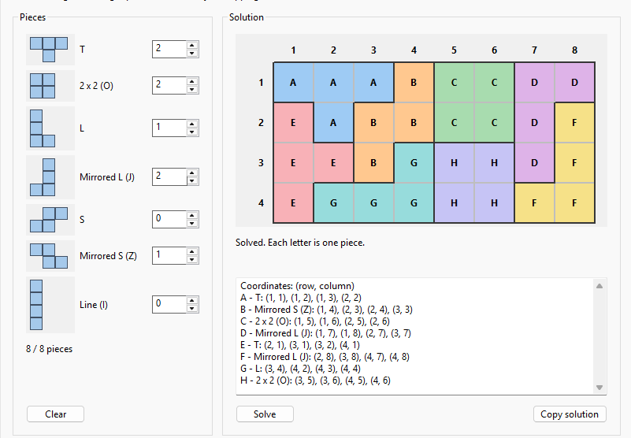
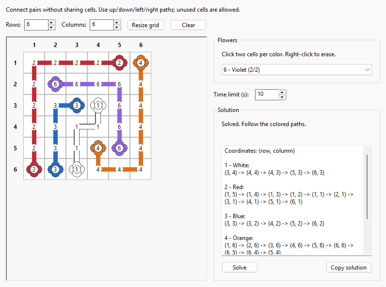
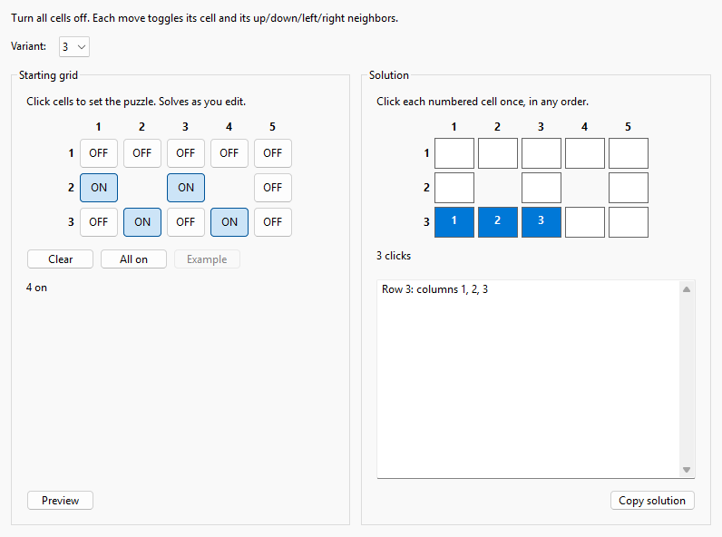

# talebound-puzzle-solver

A simple desktop app that visualizes solutions to various puzzles in the upcoming Talebound gamemode in World of Warcraft. Currently supports the "Tetris", flowers, and mushroom puzzles.

## Screenshots

## Downloading

Download and run the `.exe` from the [latest release.](https://github.com/depthbomb/talebound-puzzle-solver/releases/latest)